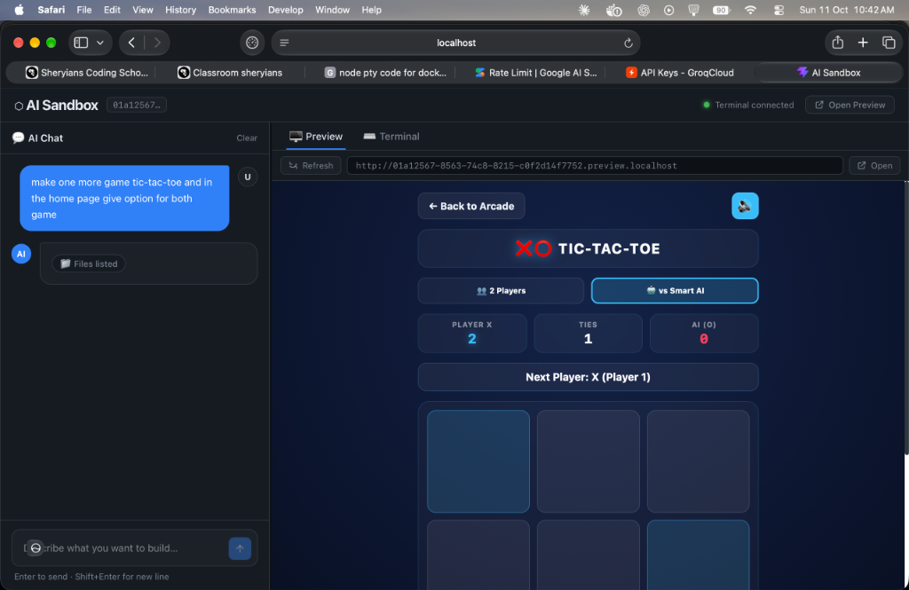
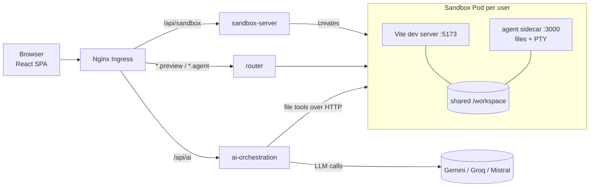
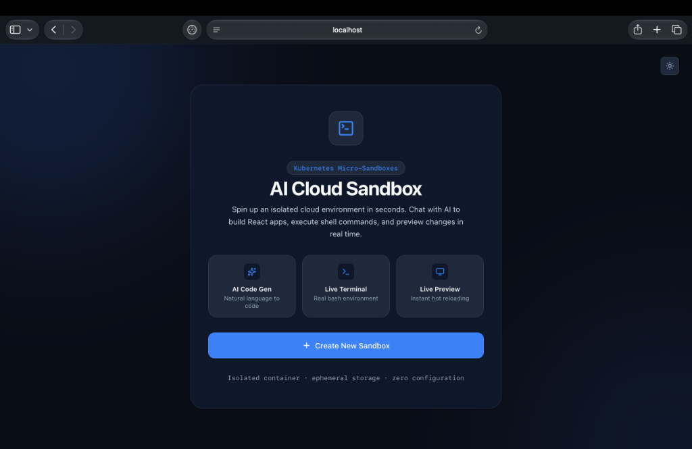
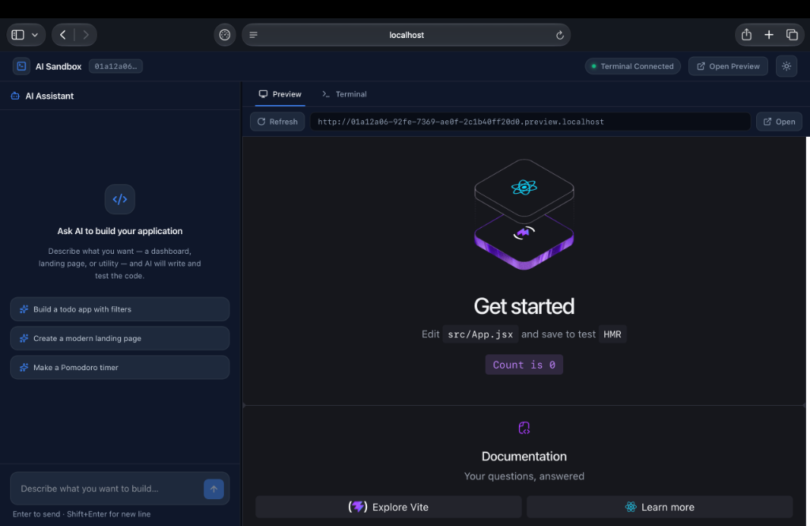
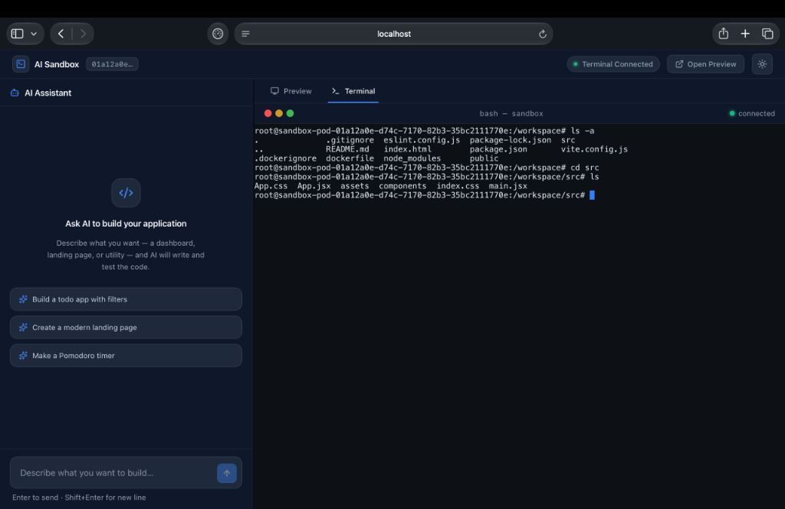

# ⬡ AI Cloud Sandbox

Describe an app in chat. An AI agent writes the code inside an isolated Kubernetes sandbox, and you watch it run live in your browser.

Each sandbox is its own Kubernetes Pod with a Vite + React dev server, a real bash terminal, and a file API. A LangChain tool-calling agent edits the project files, and Vite hot-reloads the preview as the code changes.




---

## Features

- **One-click sandboxes:** Each sandbox is a dedicated Kubernetes Pod and Service created on demand, with its own workspace seeded from a React + Vite template.
- **AI coding agent:** The LangChain agent has five specialized tools (`list_files`, `read_files`, `patch_file`, `update_files`, `check_app`). It prefers small targeted patches over rewriting whole files to conserve tokens.
- **Live streaming:** Agent steps (reading, patching, creating files) and the final response stream to the UI in real time over Server-Sent Events (SSE).
- **Multiple LLM providers:** Seamlessly switch between Google Gemini, Groq, and Mistral with a single environment variable.
- **Live preview:** Each sandbox gets its own subdomain (`<id>.preview.localhost`) where Vite Hot Module Replacement (HMR) updates the view instantaneously as files change.
- **In-browser terminal:** Full `@xterm/xterm` emulator connected over Socket.IO to a real bash session (`node-pty`) running inside the sandbox.
- **Workspace UI:** Resizable chat/preview split pane, Preview and Terminal tabs, and customizable dark and light themes.

---

## Architecture



### How a Request Flows

1. **Create:** The frontend calls `POST /api/sandbox/start`. `sandbox-server` creates `sandbox-pod-<id>` and `sandbox-service-<id>` through the Kubernetes API and returns the ID.
2. **Chat:** The frontend calls `POST /api/ai/invoke`. The agent calls the LLM, which uses tools that target the sandbox's agent sidecar. Steps stream back to the client as SSE.
3. **Preview:** The iframe loads `<id>.preview.localhost`. Ingress sends the request to the router, which reads the subdomain and proxies to `sandbox-service-<id>:80`.
4. **Terminal:** The browser connects a WebSocket to `<id>.agent.localhost`, proxied to the sidecar, which pipes stdin/stdout to an internal `node-pty` bash process.

> **Note:** The dynamic router means no new Ingress rule is needed per sandbox. A single wildcard rule (`*.preview.localhost` and `*.agent.localhost`) handles all of them.

---

## Tech Stack

| Layer | Technology |
|---|---|
| **Frontend** | React 19, Vite 8, Tailwind CSS 4, React Router 7, xterm.js 6, Socket.IO client |
| **AI Orchestration** | Node.js, Express 5, LangChain 1.5, LangGraph 1.4, Zod, Axios |
| **LLM Providers** | `@langchain/google-genai`, `@langchain/groq`, `@langchain/mistralai` |
| **Sandbox Manager** | Express 5, `@kubernetes/client-node` 2.0, UUID v7 |
| **In-pod Agent** | Express 5, Socket.IO 4, `node-pty` |
| **Routing** | `http-proxy-middleware`, Ingress-NGINX |
| **Infrastructure** | Docker, Kubernetes (RBAC, Deployments, Services, Ingress), Skaffold |

---

## Project Structure

```
Frontend/          # React SPA: chat, preview, terminal
ai-orchestration/  # LLM agent service (tools + SSE streaming)
sandbox/
├── server/        # Creates sandbox Pods and Services via the Kubernetes API
├── agent/         # In-pod sidecar: file REST API + PTY over Socket.IO
├── router/        # Wildcard-subdomain reverse proxy to sandbox services
└── template/      # React + Vite app copied into every new sandbox
k8s/               # Deployments, Services, Ingress, RBAC manifests
skaffold.yml       # Build and deploy pipeline
```

---

## Getting Started

### Prerequisites

- **Node.js:** 20 or 22
- **Docker:** BuildKit enabled
- **Kubernetes cluster:** Local cluster (Docker Desktop, Minikube, or Kind)
- **Ingress Controller:** [Ingress-NGINX](https://kubernetes.github.io/ingress-nginx/deploy/) installed in the cluster
- **LLM API Key:** At least one provider key ([Google AI Studio](https://aistudio.google.com/), [Groq](https://console.groq.com/), or [Mistral](https://console.mistral.ai/))
- *Optional:* [Skaffold](https://skaffold.dev/) 2.x

---

### 1. Create the Kubernetes Secret

The AI deployment reads its API keys from a Kubernetes secret named `my-secret`:

```bash
kubectl create secret generic my-secret \
  --from-literal=GOOGLE_API_KEY="your-key-here" \
  --from-literal=GROQ_API_KEY="your-key-here" \
  --from-literal=MISTRAL_API_KEY="your-key-here"
```

*(You only need to supply the key for the provider you choose to use.)*

---

### 2. Build and Deploy

#### Option A: Using Skaffold (Recommended)

```bash
skaffold dev
```

#### Option B: Manual Docker & Kubectl

```bash
# Build container images
docker build -t template:latest ./sandbox/template
docker build -t agent:latest ./sandbox/agent
docker build -t sandbox:latest ./sandbox/server
docker build -t router:latest ./sandbox/router
docker build -t ai-orchestration:latest ./ai-orchestration

# On Minikube or kind, load the local images into the cluster:
# minikube image load template:latest agent:latest sandbox:latest router:latest ai-orchestration:latest
# kind load docker-image template:latest agent:latest sandbox:latest router:latest ai-orchestration:latest

# Apply Kubernetes manifests in order
kubectl apply -f k8s/rbac.yml
kubectl apply -f k8s/ai-deployment.yml -f k8s/ai-service.yml
kubectl apply -f k8s/sandbox-deployment.yml -f k8s/sandbox-service.yml
kubectl apply -f k8s/router-deployment.yml -f k8s/router-service.yml
kubectl apply -f k8s/ingress.yml
```

---

### 3. Run the Frontend

```bash
cd Frontend
npm install
npm run dev
```

Open [http://localhost:5173](http://localhost:5173). The Vite development server automatically proxies `/api/sandbox` and `/api/ai` to the ingress on `http://localhost:80`.

> **DNS Note:** Chromium-based browsers resolve `*.localhost` automatically to `127.0.0.1`. In Firefox or Safari, you may need a `/etc/hosts` or `dnsmasq` entry for the wildcard subdomains (`*.preview.localhost` and `*.agent.localhost`).

---

### 4. Verify

```bash
# Check sandbox service health
curl http://localhost/api/sandbox/health

# Check active sandbox pods after creating one from the UI
kubectl get pods -l app=sandbox
```

---

## Configuration

### `ai-orchestration`

| Variable | Required | Description |
|---|---|---|
| `MODEL_PROVIDER` | No | Model provider: `gemini` (default), `groq`, or `mistral`. |
| `MODEL_NAME` | No | Overrides default model name. Explicitly set to a model supported by your key (e.g., `gemini-2.0-flash` or `llama-3.3-70b-versatile`). |
| `MODEL_TEMPERATURE` | No | Sampling temperature (default: `0.2`). |
| `GOOGLE_API_KEY` | Conditional | Required if `MODEL_PROVIDER=gemini`. |
| `GROQ_API_KEY` | Conditional | Required if `MODEL_PROVIDER=groq`. |
| `MISTRAL_API_KEY` | Conditional | Required if `MODEL_PROVIDER=mistral`. |

### Frontend *(Optional, for running without the ingress)*

| Variable | Default | Description |
|---|---|---|
| `VITE_AGENT_URL` | `http://<id>.agent.localhost` | Direct URL override for sandbox agent WebSocket. |
| `VITE_PREVIEW_URL` | `http://<id>.preview.localhost` | Direct URL override for sandbox preview iframe. |

---

## API Reference

### `sandbox-server`

| Method | Path | Description |
|---|---|---|
| `GET` | `/api/sandbox/health` | Health check endpoint |
| `POST` | `/api/sandbox/start` | Creates a new sandbox Pod & Service; returns `{ sandboxId, previewUrl }` |

### `ai-orchestration`

| Method | Path | Description |
|---|---|---|
| `POST` | `/api/ai/invoke` | Request body: `{ message, projectId }`. Streams SSE events (`log`, `tool_done`, `text`, `error`) and terminates with `[DONE]`. |
| `GET` | `/api/status/healthz`, `/readyz` | Liveness and readiness health probes |

### `sandbox-agent` (Inside each Pod)

| Method | Path / Event | Description |
|---|---|---|
| `GET` | `/list-files` | Lists project files in `/workspace` (excluding `node_modules` and `.git`) |
| `GET` | `/read-files?files=a,b` | Reads and returns contents of specified files |
| `PATCH` / `POST` | `/update-files` | Body: `{ updates: [{ file, content }] }` - writes or updates files |
| `POST` | `/create-files` | Body: `{ files: [{ file, content }] }` - creates new files |
| `GET` | `/check-up` | App health check endpoint (currently returns static ok) |
| Socket.IO | `terminal-input` | Sends user keystrokes / commands to the container bash PTY |
| Socket.IO | `terminal-output` | Emits stdout / stderr from the container bash PTY |

<!-- ---

## Known Limitations

This platform was built as an architectural capstone project and is not yet production-hardened:

- **No authentication:** Any client with network access can create sandboxes and interact with container shells.
- **No automated cleanup:** Sandboxes run until manually removed; no TTL controller or pod garbage collection is currently implemented.
- **File API path validation:** The sandbox agent does not strictly enforce boundary checks preventing paths escaping `/workspace`.
- **`check_app` is a stub:** Returns a static `{ status: "ok" }` response rather than inspecting Vite compiler logs.
- **Shared terminal session:** All clients connected to the same sandbox share a single `node-pty` instance, and client terminal resize geometry is not synced.
- **Ephemeral chat state:** Conversation history is stored in client React state and is reset on page refresh. -->

---

## Roadmap

- [ ] User authentication and per-user sandbox ownership
- [ ] TTL-based sandbox cleanup (Kubernetes CronJob or background reconciler)
- [ ] Real build verification in `check_app` using Vite compiler logs / `npm run build`
- [ ] Strict path traversal validation and Kubernetes NetworkPolicies
- [ ] Per-connection PTY sessions with terminal resize synchronization
- [ ] Persistent conversation history and project zip export

---

## Screenshots

### 1. Landing Page & Sandbox Launcher
Spin up an isolated cloud sandbox on Kubernetes with zero configuration:


### 2. Live Preview & Workspace Split View
Synchronized split-pane interface with AI chat on the left and instant Vite HMR preview on the right:


### 3. In-Browser Terminal
Full interactive bash terminal session powered by `node-pty`, Socket.IO, and `@xterm/xterm`:


---

## Author

Shrey Patel
